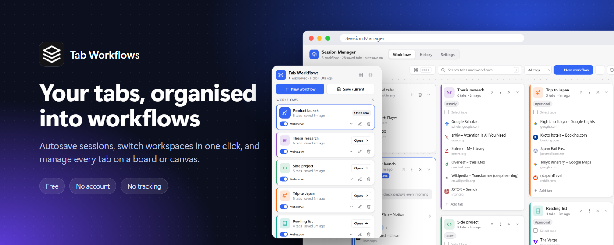
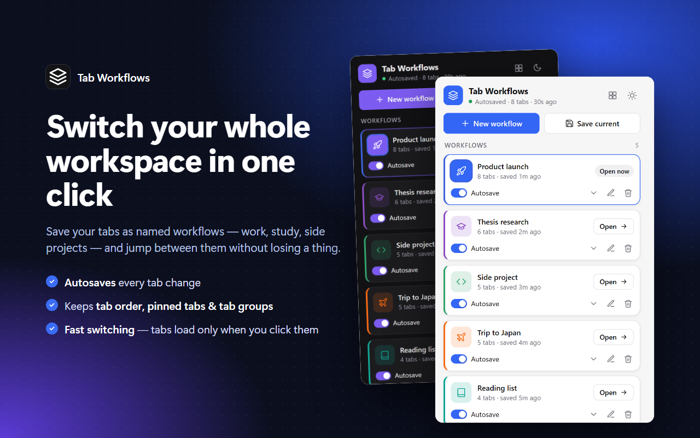
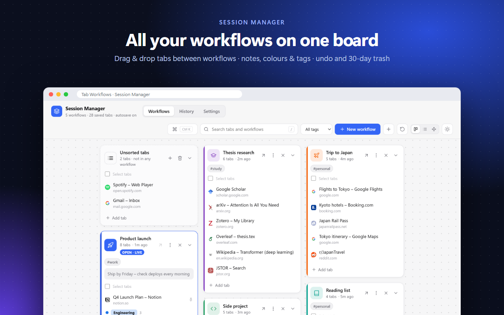
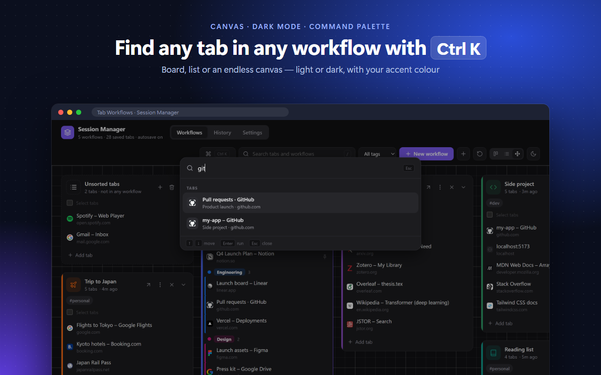

<div align="center">


# Tab Workflows

**Save your tabs as named workflows and switch between them in one click — with session autosave, tab groups, a drag-and-drop Session Manager, undo, backups and Chrome sync. Free, no account, no tracking.**


[**Install from the Chrome Web Store**](https://chromewebstore.google.com/detail/ipfjagejbpcgddgbcpllbiahgaljmclg?utm_source=item-share-cb) · [Report a bug](https://github.com/reapertakumi/Tab-Workflows/issues)



</div>

---

Tab Workflows is a **tab manager and session saver for people who juggle several projects at once**. Group the tabs you need for each task — work, study, a side project, trip planning — into a **workflow**, and swap your whole browser window from one to another in a single click. Every change is **autosaved**, so you never lose a session again.

The **Session Manager** shows every workflow on a board, a list or an endless canvas, where you can drag tabs between workflows, tag and colour them, search everything, and undo any mistake.

## ✨ Features

### 🔁 Workflows & switching
| Feature | What it does |
|---|---|
| **One-click switching** | Closes the current workflow and opens the next one in the same window, tabs in the saved order. |
| **Session autosave** | Every tab change saves the whole session again — per workflow, with an on/off switch for each. |
| **Fast switching (lazy load)** | Only the tab you're looking at loads; the rest load when you click them, keeping their names and icons. |
| **New-window mode** | Optionally open each workflow in its own window, so several can be open (and autosaving) at once. |
| **Tab groups** | Chrome tab groups are saved with name, colour and collapsed state, and re-created on open. |
| **Pinned tabs & multiple windows** | Pinned tabs stay pinned; extra windows in a workflow open as their own windows. |

### 🗂️ Session Manager
- Three layouts: **Board** (resizable columns), **List** and **Canvas** — an endless canvas with zoom, where workflows you drag or resize onto others push them out of the way.
- **Drag & drop** tabs between workflows or to reorder them (hold **Ctrl** to copy).
- **Multi-select** tabs to copy, move or remove them in bulk.
- **Notes, colour labels and tags** on every workflow, with a tag filter.
- **Search** (`/`) across all tabs, workflows, notes and tags.
- Rename tabs, edit links, sort by title or website, **remove duplicates**, copy all links.
- **Unsorted tabs** inbox for links you haven't filed yet.

### ⌨️ Keyboard first
- **`Ctrl+Shift+K`** opens the popup from anywhere.
- **`Ctrl+K`** (in the Session Manager) opens the **command palette**: find any tab in any workflow, switch workflows, or run any command.
- **`Ctrl+Z`** undo · **`/`** search · **`Esc`** close.

### 🛟 Safety net
- **Undo & history:** most changes show an *Undo* toast, and the History tab lets you roll back to any recent point.
- **Trash:** deleted workflows and removed tabs are kept for 30 days.
- **Daily backups:** the last 10 are kept inside the extension, optionally also as a JSON file in your Downloads folder.
- **Chrome sync (optional):** sync workflows to your other computers through your Chrome profile.
- **Import / export** workflows as JSON, or import a plain list of links.

### 🎨 Make it yours
Light, dark or system theme · 6 accent colours · backgrounds (dots, grid, graph paper, gradient, aurora…) · 4 tab display styles (Compact, Comfortable, Detailed, Icons).

## 📸 Screenshots

| Popup | Board | Canvas & command palette |
|---|---|---|
|  |  |  |

## 📦 Installation

### Chrome Web Store (recommended)
Install it from the [**Chrome Web Store**](https://chromewebstore.google.com/detail/ipfjagejbpcgddgbcpllbiahgaljmclg?utm_source=item-share-cb). Updates install automatically. Works in Chrome, Edge, Brave and other Chromium browsers.

### Manual install (developer mode)
1. Download the latest release ZIP from [Releases](https://github.com/reapertakumi/Tab-Workflows/releases) and unzip it, or clone the repo:
   ```bash
   git clone https://github.com/reapertakumi/Tab-Workflows.git
   ```
2. Open `chrome://extensions/` (or `edge://extensions/`).
3. Turn on **Developer mode** (top right).
4. Click **Load unpacked** and select the extension folder.
5. Pin the extension so its button stays on the toolbar.

## 🚀 How to use
1. Open a few tabs for something you're working on, click the extension icon (or press `Ctrl+Shift+K`) and choose **Save current**. Give it a name and an icon.
2. Click **New workflow** to start fresh on an empty tab — your first workflow is autosaved and closed.
3. Click **Open** on any workflow to switch back. Your tabs return in the same order, with their tab groups.
4. Click the **grid** button in the popup to open the **Session Manager** and organise everything with drag & drop.
5. Visit **Settings** in the Session Manager for themes, layouts, switching mode, backups and sync.

## 🔒 Privacy
- **No accounts, no ads, no analytics, no tracking.** The extension doesn't collect, send or sell any data.
- Workflows and settings are stored locally with Chrome's own storage. Nothing leaves your computer unless you turn on **Chrome sync**, which uses your own Chrome profile.
- Website icons come from Chrome's built-in favicon cache — no external icon service is contacted.

### Why the permissions are needed
| Permission | Used for |
|---|---|
| `tabs` | Reading the URLs and titles of your open tabs so they can be saved, and opening, moving and closing tabs when you switch workflows |
| `tabGroups` | Saving and re-creating Chrome tab groups (name, colour, collapsed) |
| `storage` | Saving your workflows and settings (and Chrome sync, if you turn it on) |
| `unlimitedStorage` | Keeping larger collections, the undo history, the 30-day trash and daily backups without hitting the 10 MB limit |
| `alarms` | Running the daily backup on time |
| `favicon` | Showing website icons from Chrome's local cache |
| `contextMenus` | The right-click menu on pages and links: **Send to** (saves the page into a workflow and closes the tab), **Copy to** (saves it, the tab stays open) and **Save link to** (saves a link without opening it). The menu only lists your workflow names; it reads nothing from the page except the address and title of the tab or link you right-clicked, and only when you pick an item |
| `downloads` *(optional)* | Only requested if you choose to save backup files to your Downloads folder |

## 🗂️ Project structure
| File | Purpose |
|---|---|
| `manifest.json` | Extension manifest (MV3) |
| `background.js` | Autosave, window ↔ workflow tracking, switching and all workflow/tab edits |
| `bg-extras.js` | Undo history, trash, tab groups, move current tab, backups, Chrome sync |
| `context-menu.js` | Right-click menu: send / copy a tab or save a link into a workflow |
| `popup.html/.css/.js` | The toolbar popup |
| `manager.html/.css/.js` | The Session Manager (board, list, canvas, history, settings) |
| `palette.js/.css` | The `Ctrl+K` command palette |
| `settings.js` | Default settings and shared helpers |
| `theme.css/.js`, `icons.js` | Shared theme, colours and line icons |
| `store-assets/` | Chrome Web Store screenshots and promo tiles (not part of the extension package) |

## 💬 Feedback & contributing
Found a bug or have an idea? [Open an issue](https://github.com/reapertakumi/Tab-Workflows/issues). Pull requests are welcome.

---

<sub>Keywords: tab manager · session manager · session saver · save tabs · restore tabs · workspaces · tab groups · tab organizer · workflow manager · productivity extension · too many tabs · switch projects · Chrome extension · Edge extension</sub>

## Switching (Replace mode)
The workflow you leave is closed (it's saved) and the one you pick opens in the same window. Its tabs
are opened, put in order, pinned and put back in their Chrome tab groups *before* the first one is
shown, then the old tabs close – so you never see tabs pop in ungrouped.
- Canvas scrolling: with the mouse over a workflow, the wheel only scrolls that workflow's tabs (and
  stops at the end); scroll over the empty canvas to move around. Ctrl + scroll zooms anywhere.
- Tab groups of the workflow you leave are **deleted** from the browser (no copies pile up in Chrome's
  saved tab groups) and rebuilt when the workflow opens again. A **copy of each deleted group** is kept
  in History → **Deleted tab groups** (newest copy per group, up to 100) – Open reopens it as a group in
  your current window.

## Sync between browsers (Settings → Sync)
Settings now has a side menu (Appearance, Saving, Switching, Backups, Sync, Data, About). On **Sync**
you pick one method; for the four multi-browser methods you set the **same passphrase in every
browser** – workflows are encrypted with it (AES-256) before they leave the browser, so the storage
can't read them. Browsers merge: the newest version of each workflow wins, deletions carry over.

| Method | Works in | How it syncs |
|---|---|---|
| **Chrome profile** | Chrome only | Your Chrome account (≈100 KB limit) |
| **Shared folder** | Chrome, Helium, Brave (enable `brave://flags/#file-system-access-api`) | A folder you pick in each browser – on this PC, or a Dropbox/OneDrive/Google Drive folder for other computers. Syncs while the Session Manager page is open (on open, every 2 min, after changes). |
| **GitHub Gist** | all | Private gist on your GitHub account; paste a token with only the "gist" scope. Automatic (every 5 min + after changes). |
| **Your own server** | all | A free Cloudflare Worker you set up once – see `sync-server/README.md` (code in `sync-server/worker.js`). Automatic. |
| **WebDAV** | all | Nextcloud, Koofr, ownCloud…: folder address + username + app password. Automatic. |

Changing the passphrase: save the new one in every browser and use "Overwrite synced copy" once.
